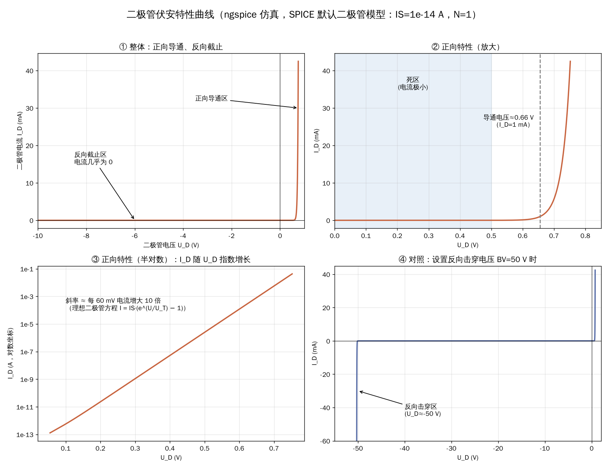
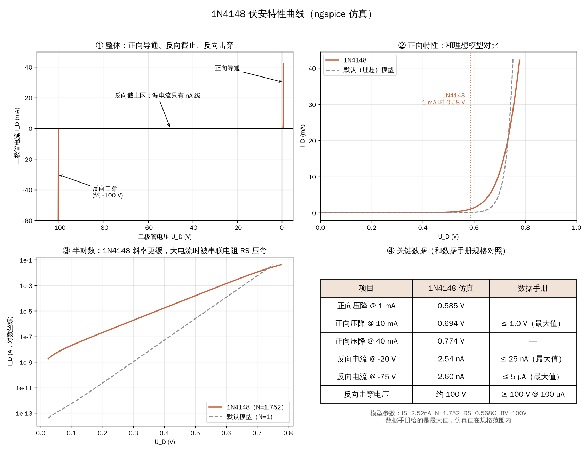
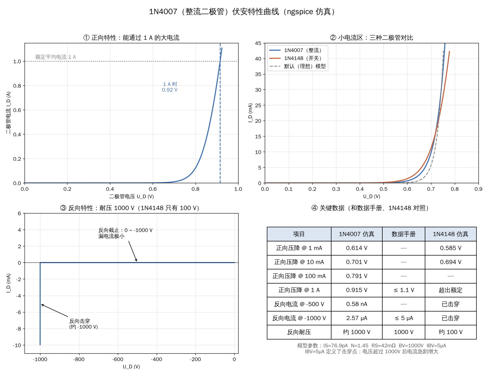

# 二极管伏安特性仿真

## 仿真电路
直流电压源 V1 → 限流电阻 R1（100 Ω）→ 二极管 D1 → 地。
扫描 V1（-10 V ~ +5 V），记录二极管两端电压 U_D 和流过它的电流 I_D。
二极管不指定型号，用 SPICE 默认模型（IS = 1e-14 A，N = 1）。

## 结果
| 项目 | 数值 |
|---|---|
| 死区 | 约 0 ~ 0.5 V，电流小于 2.5 µA |
| 导通电压（I_D = 1 mA） | 约 0.66 V |
| I_D = 10 mA 时 | 约 0.72 V |
| 反向电流（U_D = -5 V） | 约 -5 pA，几乎为 0 |

正向电压每增加约 60 mV，电流增大约 10 倍，符合二极管方程 I = IS·(e^(U/U_T) − 1)。
默认模型没有设反向击穿；图④另外设了 BV = 50 V，作为对照展示击穿区。

说明：反向电流 -5 pA 主要来自仿真器为了收敛加的并联小电导 GMIN（1e-12 S），
不是二极管本身的反向饱和电流（1e-14 A）。Multisim 用的也是 SPICE，默认 GMIN 相同。

## 在 Multisim 里自己做一遍
1. 放元件：
   - Place → Sources → DC_POWER（直流电压源）
   - Place → Basic → RESISTOR，100 Ω
   - Place → Diodes → DIODE_VIRTUAL（虚拟二极管，不指定型号）
   - Place → Sources → GROUND
2. 连线：电源正极 → 电阻 → 二极管阳极（三角形那头），二极管阴极 → 地，电源负极 → 地。
3. Simulate → Analyses and Simulation → **DC Sweep**：
   - Source 1 选这个直流电源，Start -10 V，Stop 5 V，Increment 0.005 V
   - Output 页添加二极管电流，例如 I(D1)，或者 I(V1) 再取负号
4. Run，得到 I_D 随电源电压变化的曲线。
   想让横轴是二极管电压：在 Grapher 里用 Trace → Set X-Y，或者把横轴变量换成二极管阳极节点电压 V(a)。
5. 也可以不加电阻，直接扫描二极管两端电压；正向扫到 0.8 V 左右就够了，再高电流会大得不真实。

## 文件
- `diode_iv.cir`、`diode_iv_bv.cir`：ngspice 网表
- `plot_iv.py`：画图
- `iv_table.csv`：数据表（可以直接填进实验报告）

重新生成：`ngspice -b diode_iv.cir && ngspice -b diode_iv_bv.cir && python3 plot_iv.py`

## 1N4148 仿真

模型：常用的 1N4148 SPICE 模型（IS=2.52nA，N=1.752，RS=0.568Ω，与 LTspice 自带库里的参数相同），
按数据手册补了反向击穿 BV=100V @ 100µA。电路同上，电源从 -120V 扫到 +5V。

| 项目 | 仿真 | 数据手册 |
|---|---|---|
| 正向压降 @ 1 mA | 0.585 V | — |
| 正向压降 @ 10 mA | 0.694 V | ≤ 1.0 V |
| 反向电流 @ -20 V | 2.5 nA | ≤ 25 nA |
| 反向电流 @ -75 V | 2.6 nA | ≤ 5 µA |
| 反向击穿 | 约 100 V | ≥ 100 V |

在 Multisim 里：Place → Diodes → DIODE，Component 选 1N4148，其他步骤一样（电源扫到 -120V 就能看到击穿）。

文件：`diode_1n4148.cir`、`plot_1n4148.py`、`iv_1n4148_table.csv`

## 1N4007（整流二极管）仿真

模型：IS=76.9pA，N=1.45，RS=42mΩ，BV=1000V，IBV=5µA。
正向用 10Ω 限流电阻扫 0~12V（电流到 1A 左右），反向换 10kΩ 扫到 -1100V。

| 项目 | 1N4007 | 数据手册 | 1N4148 |
|---|---|---|---|
| 正向压降 @ 1 mA | 0.614 V | — | 0.585 V |
| 正向压降 @ 10 mA | 0.701 V | — | 0.694 V |
| 正向压降 @ 1 A | 0.915 V | ≤ 1.1 V | 超出额定 |
| 反向电流 @ -1000 V | 2.6 µA | ≤ 5 µA | 已击穿 |
| 反向耐压 | 约 1000 V | 1000 V | 约 100 V |

文件：`diode_1n4007.cir`、`plot_1n4007.py`、`iv_1n4007_table.csv`
