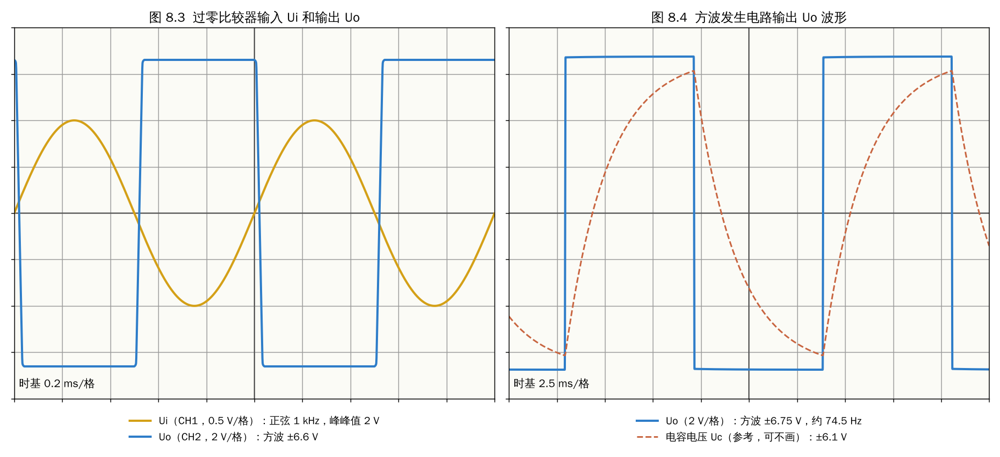

# 运算放大器的非线性应用（实验 8）仿真

运放用近似 μA741 的行为模型（带输出饱和和 0.5 V/µs 压摆率），±12V 供电；Dz 为两只 6V 稳压管背靠背。
`ngspice -b cmp.cir`（过零比较器）、`ngspice -b sq.cir`（方波发生器）、`python3 plot_wave.py`（画图 8.3、8.4）

## 表 8.1 过零比较器（输入假设为 1 kHz 正弦、峰峰值 2 V）
| Uo/V | ±6.6（峰峰值约 13.2） |
|---|---|
| f0/Hz | 1000（与输入频率相同） |

Ui > 0 时 Uo 为负，Ui < 0 时 Uo 为正（信号从反相端输入），在过零点翻转。
Uo 被 Dz 限幅在 ±(Uz + U_D) ≈ ±(6 + 0.6) V。

## 表 8.2 方波发生电路（按书上图 8.2 接法）
| Uo/V | ±6.75（峰峰值约 13.5） |
|---|---|
| f0/Hz | 约 74.5 |

理论：正反馈系数 F = R1 / (R1 + Rf) = 100k / 110k ≈ 0.91，
T = 2·R2·C·ln(1 + 2R1/Rf) = 2 × 10k × 220n × ln(21) ≈ 13.4 ms，f0 ≈ 74.6 Hz，与仿真一致。
